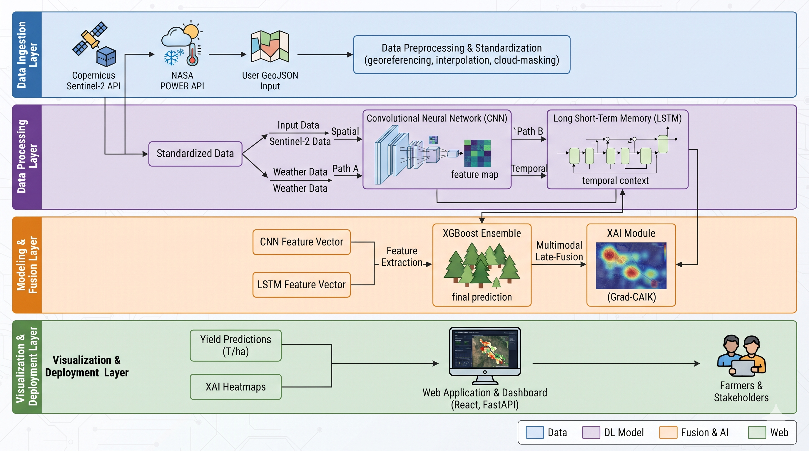
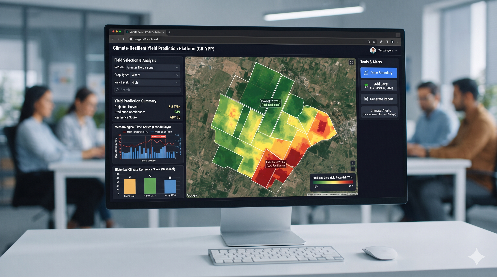

# Major-project
# Climate-Resilient Crop Yield Prediction using Multimodal Remote Sensing Data[cite: 2]

[]()
[]()
[]()

## 📋 Overview
The sustainability of the global agriculture industry is currently facing threats due to climate change and non-stationary climate patterns[cite: 5]. Early and accurate crop yield prediction in the initial growing stages is necessary in maintaining the food chain's sustainability and supply chain[cite: 5]. This project presents an integrated multimodal deep learning framework that fuses spatial vegetation analysis from Copernicus Sentinel-2 satellite imagery with sequential meteorological time-series data from NASA POWER, backed by an intuitive map-based SaaS dashboard[cite: 1, 5, 14].

---

## 🏛️ Project Team & Academic Details
* **Rohan Kumar Singh** (2410030366)
* **Ayush Ranjan** (2410030329)[cite: 1]
* **Sejal Sharma** (2410030263)[cite: 1]
* **Raj Kumar Jha** (2410030379)[cite: 1]
* **Faculty Guide:** Yamini Singh[cite: 1]
* **Institution:** School of Computer Science and Engineering, IILM University, Greater Noida[cite: 1]

---

## 📐 System Architecture
[cite: 17]

---

## 🖥️ Dashboard User Interface Preview
[cite: 18]

---

## ⚙️ Core Technical Architecture
* **Spatial Ingestion & CNN:** Automatically ingests multi-spectral Sentinel-2 satellite images via Google Earth Engine to compute vegetation indices (NDVI, EVI) and extract spatial feature vectors using a custom Convolutional Neural Network[cite: 1, 8, 14].
* **Temporal Ingestion & LSTM:** Processes sequential meteorological time-series data (temperature variation, rainfall rates, relative humidity) via NASA POWER / ERA5 to capture regional temporal climate dependencies and sequential weather stress[cite: 1, 8, 14].
* **Multimodal Late-Fusion & XGBoost:** Combines spatial features, temporal features, and static variables using an XGBoost ensemble framework to optimize prediction accuracy (RMSE) and generate localized yield predictions in Tons per Hectare ($T/ha$)[cite: 1, 8, 9, 14].
* **Explainable AI (XAI):** Utilizes Grad-CAM to interpret model decisions and generate visual heatmaps highlighting crop stress[cite: 1, 8, 14].

---

## 🗂️ Repository Directory Structure
```text
├── assets/
│   ├── architecture.png         # System workflow diagram[cite: 17]
│   └── dashboard_ui.png         # Working web dashboard preview[cite: 18]
├── docs/
│   └── Major_project_report.pdf # Official Phase-I project report PDF[cite: 2]
├── backend/                     # FastAPI server & inference engine[cite: 1, 14]
├── frontend/                    # JavaScript & Tailwind CSS web dashboard[cite: 1, 14]
├── models/                      # CNN, LSTM, and XGBoost training scripts[cite: 1]
├── README.md                    # Project documentation
└── requirements.txt             # Python package dependencies[cite: 1]
